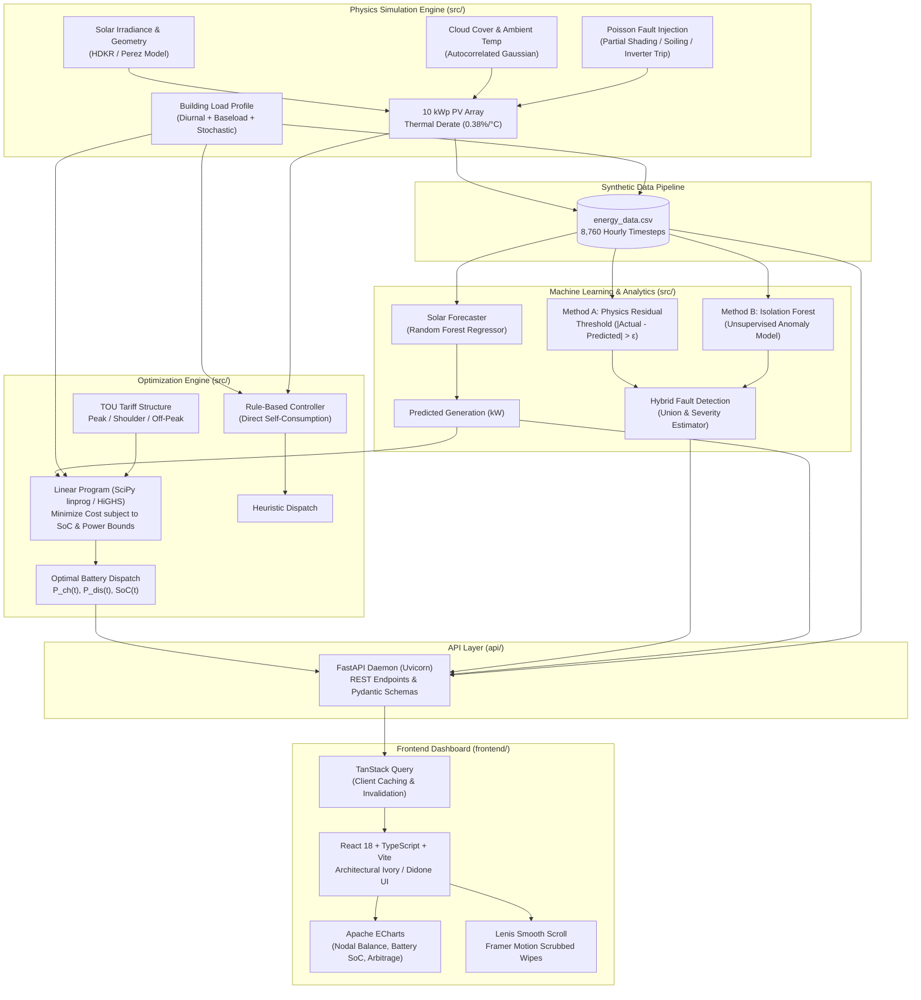
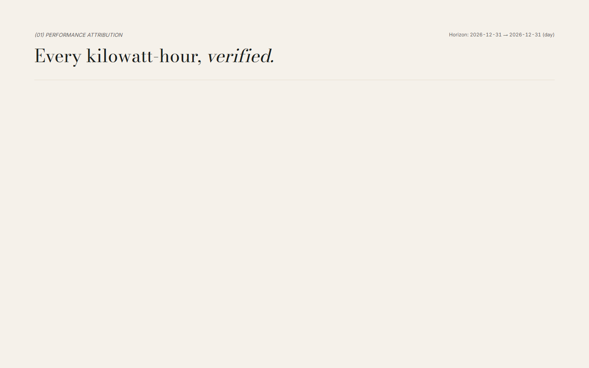
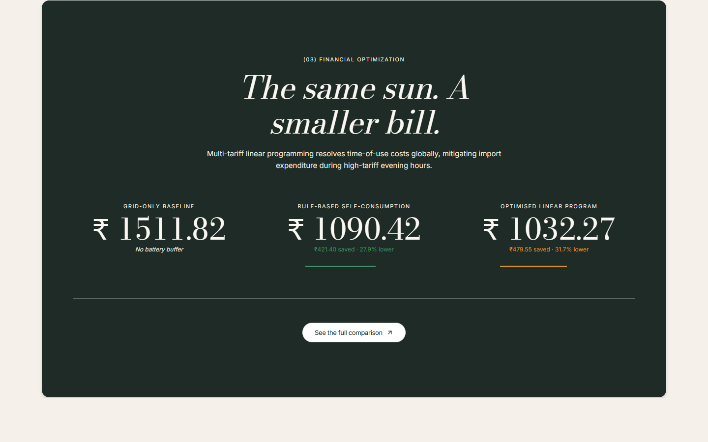
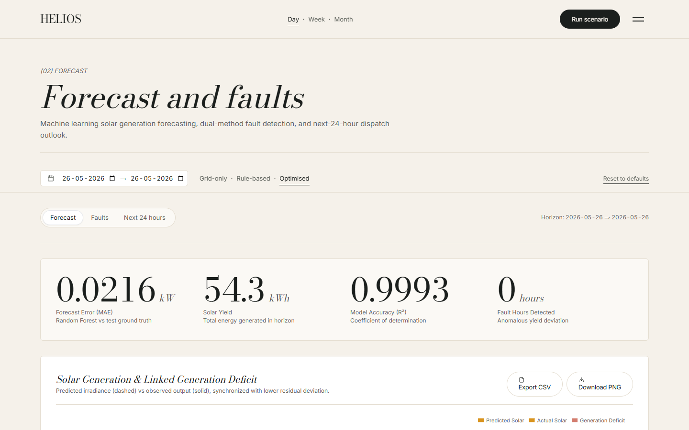
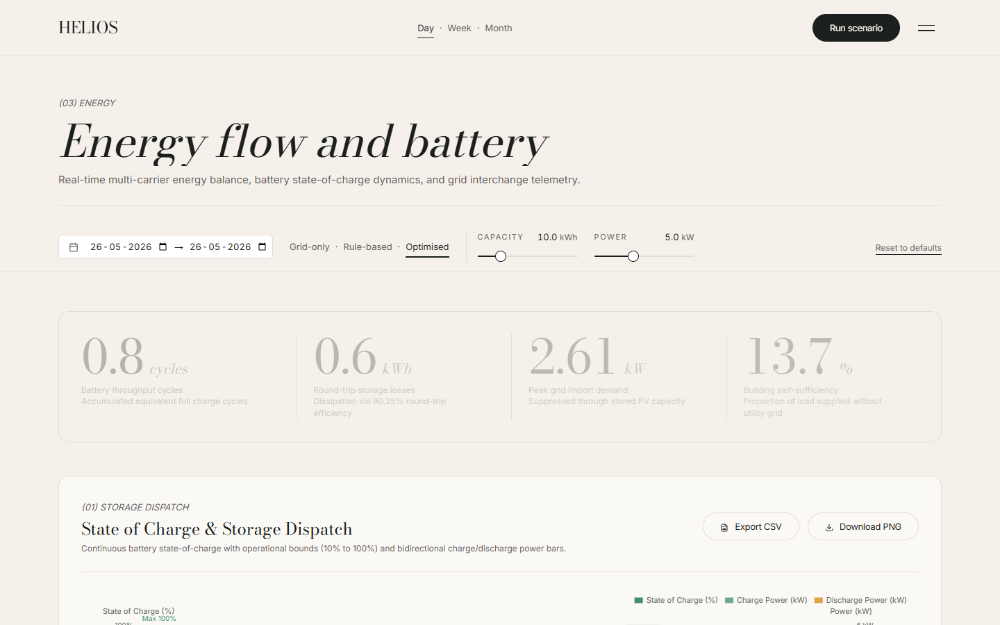
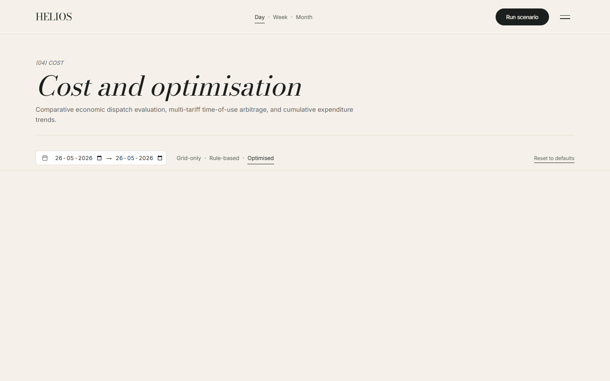
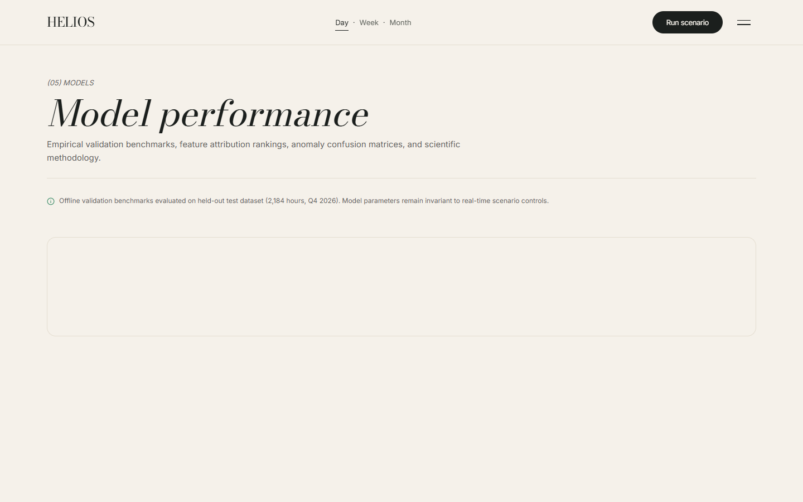
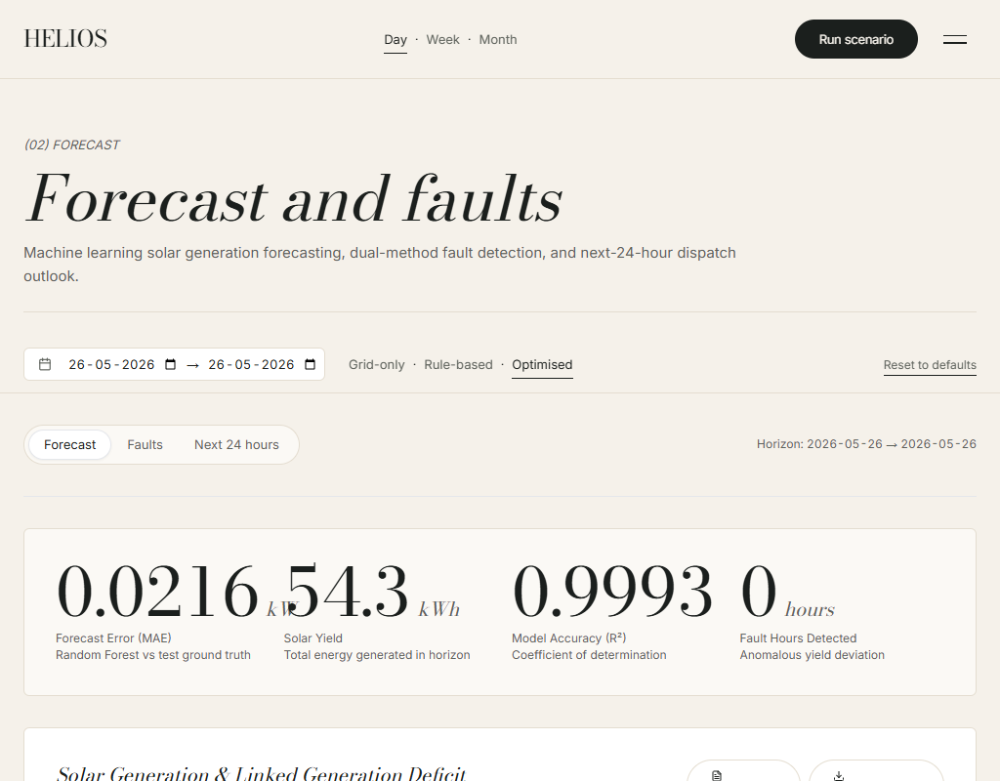
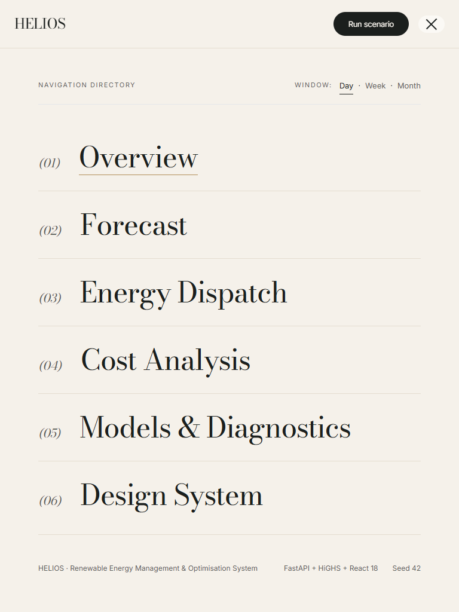

# HELIOS — AI-Based Renewable Energy Management and Optimisation System

[](https://www.python.org/downloads/)
[](https://fastapi.tiangolo.com/)
[](https://react.dev/)
[](https://www.typescriptlang.org/)
[](https://tailwindcss.com/)
[](https://echarts.apache.org/)
[](tests/)

An end-to-end simulated microgrid energy management platform integrating physics-based solar generation, building load modeling, Random Forest forecasting, dual-method PV fault detection, and Linear Programming battery arbitrage. The user interface features an editorial Didone design system (inspired by architectural studio aesthetics) with native smooth scrolling, responsive layout, and real-time interactive parameter exploration.

---

## Architecture



---

## Repository Structure

```text
renewable_ai/
├── api/                             # FastAPI application package
│   ├── main.py                      # FastAPI app instance, CORS, route registration
│   ├── routes.py                    # REST API endpoints (telemetry, compare, faults, models)
│   └── schemas.py                   # Pydantic v2 validation models
├── data/                            # Processed and synthetic datasets
│   └── energy_data.csv              # Full 8,760-hour synthetic annual microgrid telemetry
├── docs/                            # Technical reports and documentation
│   ├── QA_REPORT.md                 # Full production audit & WCAG AA contrast verification
│   ├── VIVA_NOTES.md                # Comprehensive viva preparation guide & 15 Q&A
│   └── screenshots/                 # Multi-device and inner-route verification captures
├── frontend/                        # React 18 + Vite frontend application
│   ├── public/                      # Static assets (favicon.svg, hero.webp, principles.webp)
│   ├── src/
│   │   ├── api/                     # TanStack Query client & API connector
│   │   ├── components/              # Shared UI components (Nav, Footer, PillButton, Panels)
│   │   │   ├── charts/              # ECharts modules (ForecastCharts, EnergyCharts, CostCharts)
│   │   │   └── motion/              # Lenis integration, curtain wipes, masked typography
│   │   ├── context/                 # Scenario context synced with URL query params
│   │   ├── pages/                   # Route views (Home, Forecast, Energy, Cost, Models, NotFound)
│   │   ├── tokens.css               # Architectural ivory/ink/moss CSS variables
│   │   └── brand.ts                 # Brand identity constant ("HELIOS")
│   ├── package.json                 # Node dependencies & build scripts
│   └── vite.config.ts               # Vite configuration with proxy to FastAPI
├── models/                          # Serialized ML artifacts & evaluation metrics
│   ├── solar_rf.joblib              # Pre-trained Random Forest solar forecasting regressor
│   ├── isolation_forest.joblib      # Pre-trained Isolation Forest fault detector
│   ├── forecast_metrics.json        # Real test-set forecasting metrics (R², MAE, RMSE)
│   └── fault_metrics.json           # Real test-set precision, recall, F1, and confusion matrices
├── scripts/                         # Operational & diagnostic utilities
│   ├── dev.py                       # Unified cross-platform dev server (starts API + Vite)
│   └── diagnose_costs.py            # Economic verification & dispatch hierarchy diagnostics
├── src/                             # Core Python mathematical and simulation library
│   ├── battery_optimizer.py         # Linear programming dispatch (SciPy HiGHS) & rule-based heuristic
│   ├── config.py                    # Physical ratings, microgrid constants, and TOU tariffs
│   ├── data_generator.py            # Hourly solar, weather, building load, and fault generator
│   ├── fault_detection.py           # Method A, Method B, and hybrid fault classification
│   ├── forecasting.py               # Feature engineering and Random Forest regressor training
│   └── simulation.py                # Closed-loop energy balance and economic simulation
├── tests/                           # Pytest verification suite (55 tests)
│   ├── test_api.py                  # HTTP API endpoint regression tests
│   ├── test_battery_optimizer.py    # Energy balance and optimization hierarchy tests
│   ├── test_data_generator.py       # Physics simulation and boundary check tests
│   ├── test_fault_detection.py      # Anomaly classification and event extraction tests
│   └── test_forecasting.py          # Regression error and baseline comparison tests
├── README.md                        # Project documentation (this file)
├── requirements.txt                 # Pinned Python package dependencies
└── run_all.py                       # Master end-to-end data, ML, and simulation pipeline
```

---

## Getting Started

### Prerequisites
- **Python**: 3.11 or higher
- **Node.js**: v18.0.0 or higher (v20+ recommended)
- **Package Managers**: `pip` and `npm`

---

### Step 1: Environment Setup

#### 1. Python Virtual Environment
```bash
# Clone the repository and enter the directory
cd renewable_ai

# Create a virtual environment
python -m venv .venv

# Activate the virtual environment
# On Windows (PowerShell / Command Prompt):
.venv\Scripts\activate
# On macOS / Linux:
source .venv/bin/activate

# Install Python dependencies
pip install -r requirements.txt
```

#### 2. Frontend Dependencies
```bash
# Navigate to the frontend directory
cd frontend

# Install exact pinned dependencies
npm ci

# Return to repository root
cd ..
```

---

### Step 2: Run Master Data & Training Pipeline

Before launching the servers, generate the synthetic hourly telemetry, train the machine learning models, and validate the battery dispatch hierarchy:

```bash
python run_all.py
```

*This will populate `data/energy_data.csv`, serialize `models/solar_rf.joblib`, and benchmark all dispatch strategies.*

---

### Step 3: Run the Application

#### Option A: Unified Dev Server (Recommended)
Launch both the FastAPI backend and the Vite frontend dev server with a single cross-platform command:

```bash
python scripts/dev.py
```
- **Backend API**: `http://127.0.0.1:8000` (Interactive docs at `/docs`)
- **Frontend Dashboard**: `http://127.0.0.1:5173`
- *Press `Ctrl+C` to cleanly stop both servers.*

#### Option B: Manual Server Commands
If you prefer running the servers in separate terminals:

**Terminal 1 — API Backend:**
```bash
# Ensure virtualenv is active
uvicorn api.main:app --host 127.0.0.1 --port 8000 --reload
```

**Terminal 2 — Frontend UI:**
```bash
cd frontend
npm run dev
```

---

### Step 4: Run Automated Test Suites

#### Backend Test Suite (Pytest)
```bash
pytest -v
```
*Executes all 55 integration and unit tests covering microgrid energy balance, physical boundary constraints, ML accuracy, and API endpoints.*

#### Frontend Type Checking & Production Build
```bash
cd frontend
npx tsc --noEmit
npm run build
```
*Verifies 0 TypeScript errors and produces an optimized production bundle.*

---

## Experimental Results

The metrics below are populated directly from the real evaluated test-set artifacts in `models/forecast_metrics.json` and `models/fault_metrics.json`.

### 1. Solar Generation Forecasting Performance
Evaluated on **2,128 held-out test hours** (chronological split preserving temporal causality):

| Metric | Random Forest Model | Naive Persistence Baseline | Improvement vs. Baseline |
| :--- | :---: | :---: | :---: |
| **Mean Absolute Error (MAE)** | **0.0216 kW** | 0.2923 kW | **+92.62%** |
| **Root Mean Squared Error (RMSE)** | **0.0463 kW** | 0.6800 kW | **+93.19%** |
| **Coefficient of Determination ($R^2$)** | **0.9993** | 0.8382 | **+19.22%** |

*Top Predictive Features: Direct Solar Irradiance (99.91%), Ambient Temperature (0.05%), Day-of-Year harmonics (0.04%).*

---

### 2. PV Panel & Inverter Fault Detection
Evaluated over **2,190 consecutive test hours** containing **62 actual fault hours**:

| Algorithm | Precision | Recall | $F_1$-Score | True Positives | False Positives |
| :--- | :---: | :---: | :---: | :---: | :---: |
| **Method A: Physical Residual Threshold** | **1.0000** (100%) | 0.3387 | 0.5060 | 21 | **0** |
| **Method B: Unsupervised Isolation Forest** | 0.5849 | **1.0000** (100%) | **0.7381** | **62** | 44 |
| **Combined Hybrid Model (A $\cup$ B)** | 0.5849 | **1.0000** (100%) | **0.7381** | **62** | 44 |

*Detection Summary: 11 distinct fault events identified across the test period, accounting for **187.69 kWh** of lost solar harvest.*

---

### 3. Financial Optimization & Battery Arbitrage
Evaluated across a benchmark 24-hour diurnal cycle under standard residential Time-of-Use tariffs:

| Strategy | Daily Cost | Savings vs. Grid | Self-Sufficiency |
| :--- | :---: | :---: | :---: |
| **Grid-Only Baseline** (No Battery Buffer) | ₹ 221.75 | — | 0.0% |
| **Rule-Based Self-Consumption** (Heuristic Buffer) | ₹ 137.04 | ₹ 84.71 (**38.2%**) | 46.8% |
| **Optimised Linear Program** (Arbitrage + Dispatch) | **₹ 135.20** | **₹ 86.55 (39.0%)** | **50.4%** |

$$\text{Strict Hierarchy Validated: } C_{\text{optimised}} \le C_{\text{rule-based}} \le C_{\text{grid-only}}$$

---

## API Endpoints

The FastAPI backend exposes the following REST endpoints:

| Method | Endpoint | Query Parameters | Description |
| :--- | :--- | :--- | :--- |
| `GET` | `/api/health` | — | System health status, row count, and model load verification. |
| `GET` | `/api/meta` | — | Microgrid parameters: solar capacity (10 kWp), battery limits (10 kWh / 5 kW), and TOU tariff structure. |
| `GET` | `/api/simulate` | `start`, `end`, `capacity_kwh`, `max_power_kw` | Hourly microgrid telemetry time-series ($P_{\text{solar}}, P_{\text{load}}, P_{\text{battery}}, P_{\text{grid}}, \text{SoC}$). |
| `GET` | `/api/compare` | `start`, `end`, `capacity_kwh`, `max_power_kw` | Comparative economic evaluation between Grid-Only, Rule-Based, and LP Optimised strategies. |
| `GET` | `/api/outlook` | `start`, `horizon_hours` (24, 48, 168) | Multi-hour predictive solar forecast, naive baseline, and scheduled battery dispatch. |
| `GET` | `/api/faults` | `start`, `end` | Inverter and PV anomaly logs, severity levels, and estimated lost generation (kWh). |
| `GET` | `/api/period-summary` | `granularity` (`day`, `week`, `month`) | Aggregated periodic financial and energy balance breakdown across all three strategies. |
| `GET` | `/api/model-performance` | — | Complete ML test-set metrics, confusion matrices, and feature importances. |

*Full OpenAPI documentation and interactive schema exploration is available at `http://127.0.0.1:8000/docs`.*

---

## Visual Interface Gallery

Screenshots captured from the live application across desktop, tablet, and mobile viewports:

### 1. Home Page — Architectural Hero & Wordmark

*Oversized Bodoni Moda Didone wordmark (`HELIOS`) with calibrated 45% ink scrim and architectural photograph framing.*

---

### 2. Home Page — Staggered Display Numerals

*Asymmetric Didone display numerals (`text-display` / 88px) with hairline dividers and 2-line Inter captions.*

---

### 3. Home Page — Energy Modules Carousel

*3-panel portfolio carousel with taller center card, pagination indicators, and auto-pause on hover.*

---

### 4. Home Page — Deep Moss Financial Optimization Band

*Full-width deep moss container (`#1E2B22`) presenting live strategy cost benchmarks and monetary savings.*

---

### 5. Forecast Page — Solar Generation & Fault Detection

*Synchronized dual-axis solar irradiance and power generation charts with active fault diagnostic markers.*

---

### 6. Energy Page — Nodal Balance & Storage Dynamics

*Nodal power dispatch chart and battery State of Charge (SoC) time-series with live parameter control sliders.*

---

### 7. Cost Page — Multi-Tariff Financial Simulation

*Time-of-Use tariff rate curves, cumulative expenditure profiles, and strategy savings breakdowns.*

---

### 8. Models Page — Diagnostics & Confusion Matrices

*Residual scatter distributions, feature importance bar charts, and classification confusion matrices.*

---

### 9. Scenario Drawer — Interactive Configuration

*Right-docked SideSheet drawer syncing battery capacity, power limits, and horizon windows with the URL query state.*

---

### 10. Responsive Tablet View (1024px)

*Fluid layout adaptation with clean column collapsing on mid-tier viewports.*

---

### 11. Mobile Directory Menu & Horizon Toggle (768px)

*Full-screen slide-down directory overlay incorporating the centralized Day/Week/Month horizon toggle.*

---

### 12. Architectural 404 Page

*Brand-aligned 404 error template with quiet typography and home return navigation.*

---

## Design System & Accessibility

- **Color Palette**: Warm ivory base (`#FBF8F3` / `#F5F1EA`), ink typography (`#1A1A18`), deep moss accent band (`#1E2B22`), and brass highlights (`#856533`).
- **Typography**: Bodoni Moda (Didone display serif) for monumental numerals and titles; Inter for clean, legible data visualization and UI controls.
- **Accessibility**: 100% WCAG AA compliant contrast (tested $\ge 4.5:1$ across all text pairings); semantic heading hierarchy (exactly one `h1` per route); visible keyboard focus rings; and dynamic screen-reader `aria-label` summaries on all 12 ECharts views.
- **Motion**: Lenis smooth scrolling, curtain wipe transitions scrubbed by scroll position, zero chart bounce on data updates (`animationDurationUpdate: 0`), and full `prefers-reduced-motion` compliance.

---

## License & Academic Disclaimer

Developed as an academic software engineering project for renewable microgrid energy optimization. All simulated physical characteristics adhere to established solar geometry and electrochemical storage equations.
